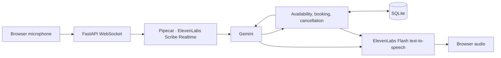

# Cedar Clinic

Cedar Clinic is a browser-based voice assistant for scheduling doctor appointments. In one call, a caller can check a doctor's availability, book an open slot, or cancel an existing appointment. The dashboard shows the conversation, available times, and booking updates as they happen.

## Quick start

You'll need Python 3.11 or 3.12, a browser with microphone access, a Google Gemini API key, and an ElevenLabs API key with **Speech to Text** and **Text to Speech** access.

From the project directory, run these commands in PowerShell:

```powershell
py -3.12 -m venv .venv
.\.venv\Scripts\python.exe -m pip install -r requirements.txt
Copy-Item .env.example .env
```

Copy the template only on first setup. Open `.env` and fill in the two API keys.

| Setting | Purpose |
| --- | --- |
| `GOOGLE_API_KEY` | Authenticates requests to Gemini. |
| `ELEVENLABS_API_KEY` | Authenticates streaming transcription and speech synthesis. |
| `GEMINI_MODEL` | Defaults to `gemini-2.5-flash`. The recorded demo used `gemini-3.5-flash-lite`. |
| `ELEVENLABS_VOICE_ID` | Defaults to the ElevenLabs George voice. |
| `CLINIC_DB` | Optional SQLite path. Defaults to `clinic.sqlite3` in the project directory. |

```powershell
.\.venv\Scripts\python.exe -m uvicorn app:app --host 127.0.0.1 --port 8000
```

Open [the local dashboard](http://127.0.0.1:8000), select **Start voice call**, and allow microphone access. The browser requires localhost or HTTPS for microphone capture. You can open `static/index.html` directly to see a styled preview with sample slots.

## Walk through a booking

1. Start a call and say a fictional phone number, then ask which times Dr. Meera Rao has tomorrow.
2. Pick one of the offered times. Listen to the digit-by-digit readback and say **Yes** if the phone number is correct.
3. Look for **Appointment booked** in the transcript. The new row appears in **Appointments** and the selected time disappears from **Doctor availability**.
4. To try cancellation, ask to cancel in the same call. Confirm the number again and check that the slot reopens.

The recorded booking demo shows the phone number readback, the appointment appearing on the dashboard, and the booked slot disappearing from availability. For the same provider configuration, use `gemini-3.5-flash-lite` and the default George voice. The demo is submitted separately as an MP4.

## How the pipeline works



The browser sends mono PCM audio over a WebSocket. Pipecat uses Silero VAD to detect speech pauses and ElevenLabs Scribe Realtime to transcribe the caller. Gemini interprets the transcript and selects the appointment tools. The backend reads the phone number aloud and waits for a separate affirmative reply before it changes a booking. ElevenLabs Flash synthesizes the spoken response. The same WebSocket carries transcript and appointment events to the dashboard.

SQLite enforces a single active booking per slot. The sample schedule uses India Standard Time, and the dashboard displays only the last four digits of each caller's number. This is a local demo with mock doctors and phone-number-only identification. Use fictional details in calls.

## Project layout

```text
app.py                         FastAPI routes and application startup
cedar_clinic/
  voice.py                     Pipecat pipeline, speech services, and Gemini tools
  confirmation.py              Spoken-number tracking and per-action confirmation
  store.py                     SQLite persistence and the mock doctor schedule
static/
  index.html                   Dashboard markup
  styles.css                   Cedar Clinic branding and responsive layout
  app.js                       Dashboard state, transcript, and call controls
  capture.js                   Browser microphone resampling and PCM capture
.env.example                   Configuration template with blank API key fields
requirements.txt               Python dependencies
```

## Troubleshooting

- **Local preview** means you opened the HTML file directly. Start FastAPI and open the local dashboard to make a call.
- **Voice provider error** may indicate an invalid key, missing permissions, unsupported voice, or exceeded quota. Check the provider account and restart the server after changing `.env`.
- **Microphone unavailable** means the browser could not start capture. Check microphone permission for the local dashboard.

Keep your local `.env` and SQLite files out of Git. Commit `.env.example` so reviewers know which settings to provide.
