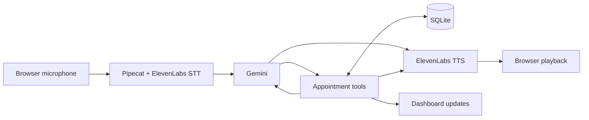

<p align="center">
  
</p>

<h1 align="center">Cedar Clinic</h1>

<p align="center"><strong>A voice assistant for booking doctor appointments</strong></p>

<p align="center">
  Check availability, book a time, or cancel an appointment in one browser call.<br>
  Follow the live transcript and see the clinic schedule update after each change.
</p>

<p align="center">
  <a href="#quick-start">Quick start</a> ·
  <a href="#try-a-booking">Try a booking</a> ·
  <a href="#voice-pipeline">Voice pipeline</a> ·
  <a href="#project-structure">Project structure</a>
</p>

## What you can do

| In the call | On the dashboard |
| --- | --- |
| Ask for a doctor’s open times. | Browse mock doctors and available slots by date. |
| Choose a slot and confirm your spoken phone number. | See the booking appear and the selected slot disappear. |
| Ask to cancel and confirm again. | See the appointment removed and the slot reopen. |

The browser uses **HTML, CSS, and JavaScript**. **FastAPI** serves the dashboard and the call WebSocket. **Pipecat**, **ElevenLabs**, and **Gemini** handle the live conversation, with **SQLite** storing appointments.

## Quick start

You'll need Python 3.11 or 3.12, a browser with microphone access, a Gemini API key, and an ElevenLabs API key with **Speech to Text** and **Text to Speech** access.

**1. Install dependencies.** In PowerShell, from the project directory:

```powershell
py -3.12 -m venv .venv
.\.venv\Scripts\python.exe -m pip install -r requirements.txt
```

**2. Configure the providers.** Create the local configuration on first setup:

```powershell
Copy-Item .env.example .env
```

| Variable | Value |
| --- | --- |
| `GOOGLE_API_KEY` | Your Gemini API key. |
| `ELEVENLABS_API_KEY` | Your ElevenLabs API key. |
| `GEMINI_MODEL` | Defaults to `gemini-2.5-flash`. The recorded demo used `gemini-3.5-flash-lite`. |
| `ELEVENLABS_VOICE_ID` | Defaults to ElevenLabs George. |
| `CLINIC_DB` | Optional SQLite path. Defaults to `clinic.sqlite3`. |

**3. Start the app.**

```powershell
.\.venv\Scripts\python.exe -m uvicorn app:app --host 127.0.0.1 --port 8000
```

Open [the local dashboard](http://127.0.0.1:8000), select **Start voice call**, and allow microphone access. Open `static/index.html` directly for a sample dashboard preview.

## Try a booking

1. Say a fictional phone number and ask, “What times does Dr. Meera Rao have tomorrow?”
2. Pick one of the times the assistant offers. Listen to the digit-by-digit readback, then say **Yes** if the number is correct.
3. Check for **Appointment booked** in the transcript and look for the new row under **Appointments**.
4. To try cancellation, ask to cancel in the same call. Confirm the number again and check that the slot reopens.

The separate **61-second demo video** shows the full booking flow, including both sides of the conversation and the dashboard update.

## Voice pipeline



The browser streams mono PCM over a FastAPI WebSocket. Pipecat uses Silero to detect speech pauses and ElevenLabs Scribe Realtime to transcribe the caller. Gemini uses the transcript to choose an appointment tool. For booking and cancellation, the backend reads the number aloud and waits for an affirmative reply before changing a booking. ElevenLabs Flash synthesizes the audio. The WebSocket also delivers transcript and appointment events to the dashboard.

SQLite allows one active booking per slot. The sample schedule uses India Standard Time, and the dashboard shows only the last four digits of a caller’s number. This demo uses mock doctors and phone-number-only identification. Use fictional details when testing.

## Project structure

```text
app.py              FastAPI routes and application startup
cedar_clinic/
  voice.py          Pipecat pipeline and Gemini appointment tools
  confirmation.py   Spoken-number tracking and confirmation
  store.py          SQLite persistence and sample schedule
static/
  index.html        Dashboard structure
  styles.css        Branding and responsive layout
  app.js            Call controls, transcript, and dashboard updates
  capture.js        Microphone audio capture and resampling
docs/               README artwork
.env.example        Configuration template
requirements.txt    Python dependencies
```

## Troubleshooting

| What you see | What to check |
| --- | --- |
| **Local preview** | Start FastAPI and open the localhost dashboard to make a call. |
| **Microphone unavailable** | Grant microphone access. Browser capture requires localhost or HTTPS. |
| **Voice provider error** | Check key permissions, model access, voice availability, and provider quota. Restart the server after editing `.env`. |

Keep API keys in your local `.env`. The repository includes a blank `.env.example` for setup.
